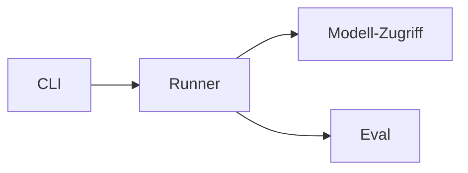

# MODULES.md format

One file at the project root, for the user and for agents. Keep it current: every feature that adds or
changes a module updates it in the same commit.

~~~markdown
# Module

Stand: <Datum> · <Commit>

| Modul | Ort | Interface (was Aufrufer wissen müssen) | Besitzt | Hängt ab von | Prüfstelle |
|---|---|---|---|---|---|
| Runner | `src/runner/` | `run(config) -> Result`; bricht bei Budget-Überschreitung ab | Lauf-Zustand, Budget | Modell-Zugriff, Eval | `tests/test_runner.py` |

## Geplant
- <Spec-Nummer>: <welches Modul wird vertieft oder neu, welches Interface ändert sich>

## Kandidaten
- <Datum> <Stärke> <Kandidat>: <Problem> → <Lösung> (Bericht: <Pfad>)
~~~

Rules:
- One row per module, named with the project's domain terms. Interface column lists invariants and error
  modes, not just signatures.
- The graph shows dependencies only (arrow = "uses"). A cycle or an arrow into another module's internals
  is a finding for `/architect`.
- Every module has a test seam, or the row says "keine" (a finding).
