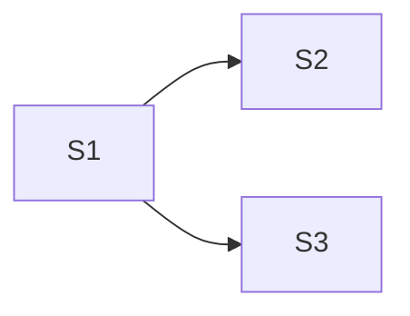

# <NN> <Titel>

Status: entwurf | abgenommen | läuft | fertig
Abnahme: <Datum, PASS durch frischen Prüf-Chat>

## Problem
Was den User stört, aus seiner Sicht.

## Lösung
Was danach anders ist, aus seiner Sicht. Bei Bedarf eine kurze nummerierte Liste von Anwendungsfällen
("Als <Rolle> will ich <Funktion>, damit <Nutzen>"), nur so viele wie Entscheidungen daran hängen.

## Entscheidungen
- Module, die gebaut oder geändert werden, und ihre Interfaces
- Architektur-, Schema-, API-Entscheidungen
- Keine Dateipfade oder Code, außer ein Prototyp hat eine Entscheidung genauer festgehalten als Prosa
  (Zustandsmaschine, Schema, Typ); dann gekürzt und als aus dem Prototyp markiert.

## Einbau
Welches Modul nimmt das Feature auf (vertieft oder neu), welches Interface ändert sich, Auszug der
geplanten Änderung an `MODULES.md`.

## Prüfung
Prüfstellen (Seams), Art der Checks, vorhandene Vorbilder im Code.

## Nicht im Umfang
Was ausdrücklich nicht gebaut wird.

## Abhängigkeiten

## Schritte

### S1 <Titel>
- [ ] erledigt
- Blockiert durch: keine
- Modus: auto | manual
- Berührt: <Module, gemeinsame Dateien>
- Liefert: <Verhalten Ende-zu-Ende, aus Sicht des Users>
- Akzeptanz:
  - <beobachtbares Ergebnis, das heute fehlt>
- Prüfbefehl: `<Befehl>` (rot am Start: ja, gesehen am <Datum> | noch zu schreiben, genau: <was er prüft>)
